<p align="center">
  <!-- 📸 ADD: logo (images/logo.png) -->
  
</p>

<h1 align="center">E-commerce Sales & Customer Analytics</h1>
<h3 align="center">From a data audit that corrected reported profit by 23% to the discount, customer, delivery and product decisions that follow from it</h3>

<p align="center">
  
  
  
  
  
  
</p>

<p align="center">
  <a href="#video-walkthrough">🎥 Video</a> ·
  <a href="docs/Ecommerce_Sales_Customer_Analytics.pdf">📄 Report PDF</a> ·
  <a href="dashboard/Ecommerce_Sales_Customer_Analytics.pbix">📊 .pbix file</a> ·
  <a href="https://github.com/<your-username>">GitHub</a> ·
  <a href="https://www.linkedin.com/in/<your-profile>">LinkedIn</a>
</p>

<!-- 📸 ADD: HERO IMAGE. A clean collage of 3 or 4 of your best pages (Data Trust, Executive Overview, Discount Effectiveness, Cohorts). About 1600 x 900. Save as images/00_hero.png -->
<p align="center">
  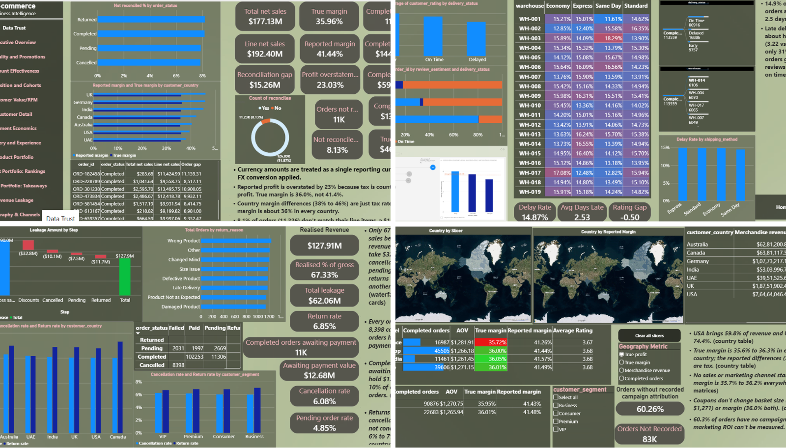
</p>

---

## Table of contents

1. [Project Title & Overview](#1-project-title--overview)
2. [Executive Summary](#2-executive-summary)
3. [Business Context & Objectives](#3-business-context--objectives)
4. [Business Questions](#4-business-questions)
5. [Dataset Overview](#5-dataset-overview)
6. [Data Audit & Quality Assessment](#6-data-audit--quality-assessment)
7. [ETL & Data Preparation](#7-etl--data-preparation)
8. [Data Model & Relationships](#8-data-model--relationships)
9. [Dashboard Preview & Walkthrough](#9-dashboard-preview--walkthrough)
10. [Key Findings & Business Recommendations](#10-key-findings--business-recommendations)
11. [DAX & Engineering Highlights](#11-dax--engineering-highlights)
12. [Skills & Technologies Demonstrated](#12-skills--technologies-demonstrated)
13. [Assumptions & Limitations](#13-assumptions--limitations)
14. [Repository Structure](#14-repository-structure)
15. [How to Access & Reproduce](#15-how-to-access--reproduce)
16. [About Me](#16-about-me)

---

## 1. Project Title & Overview

**E-commerce Sales & Customer Analytics** is a 14-page Power BI report built on five years of order data from an online retailer. It follows the full analytics workflow: audit the data, fix the metric definitions, model it properly, then answer the questions a business owner would act on.

| | |
|---|---|
| **Domain** | E-commerce / retail analytics |
| **Period** | 1 Jan 2021 to 31 Dec 2025 (1,826 days) |
| **Scale** | 138,116 orders · 397,569 order lines · 25,000 customers · 1,175 products · 7 countries |
| **Tools** | Power BI Desktop, Power Query (M), DAX |
| **Deliverables** | 14-page interactive report, data model with 84 measures, row-level security, written findings and recommendations |
| **Standout features** | Tax-adjusted profit logic, order-to-line reconciliation, cohort retention, RFM segmentation, discount what-if simulator, revenue-leakage waterfall |

<a name="video-walkthrough"></a>
**Video walkthrough**

<!-- 🎥 ADD: link to your 2-minute walkthrough (unlisted YouTube or Loom). Replace the URL below. -->
[](https://youtu.be/<your-video-id>)

---

## 2. Executive Summary

This project analyses five years (2021 to 2025) of an e-commerce business, 138,116 orders from 25,000 customers, in a 14-page Power BI report. Auditing the data first showed that the source `profit` figure includes tax, so the true margin is **36.0% rather than the reported 41.4%** and profit is overstated by 23% ($13.8M). The corrected view shows a flat business (revenue within ±2.1% every year) whose profit is being eroded by discounting: holiday promotions add 61% more orders but 6.5% less profit, orders discounted 40 to 60% earn a 3.8% margin, and a 30% cap would add about **$3.2M**. Beneath the flat top line, customer acquisition has collapsed (6,035 new customers in 2022 against 399 in 2025), about 40% of customers have gone quiet, and only 67% of gross sales becomes realised revenue. Each finding is paired with a specific action, from capping discounts and restarting acquisition to resetting delivery estimates and fixing payment failures.

| Headline metric (completed orders) | Value |
|---|---|
| Completed orders | **113,559** |
| Merchandise revenue (gross minus discounts) | **$127.9M** |
| True profit (excluding tax) / true margin | **$46.0M / 36.0%** (source says $59.8M / 41.4%) |
| Active customers per year | about **15,000** (flat) |
| Realised revenue as a share of gross sales | **67%** |

> **Short on time?** Read [9.1 Data Trust](#91-data-trust-is-our-profit-real), [9.4 Discount Effectiveness](#94-discount-effectiveness-how-deep-is-too-deep) and [9.5 Acquisition and Cohorts](#95-acquisition-and-cohorts-are-we-growing-the-customer-base).

---

## 3. Business Context & Objectives

**The scenario.** An online retailer sells through four channels (Mobile App, Website, Marketplace, Social Media) in seven countries, to four customer segments (Consumer, Business, Premium, VIP). Reported revenue looks stable and reported margins look healthy.

**The problem.** Leadership can't see where profit is actually made or lost, and doesn't know whether the reported numbers can be trusted. Revenue is flat, discounts and perks are large, and nobody can say which of them pay for themselves.

**Objectives**

1. **Establish trustworthy metrics:** audit the data and define revenue, profit and margin correctly.
2. **Diagnose profit drivers:** separate what grows profit from what only grows volume (promotions, discounts, channels, countries).
3. **Understand customers:** measure acquisition, retention and value, and find who to win back.
4. **Assess operations:** quantify the cost of late delivery, returns, cancellations and payment failures.
5. **Recommend actions** with an estimated size, and say where the data can't support a conclusion.

**Principles I followed**

- **Audit before analysis.** Definitions and data quality come first.
- **Every takeaway points to a visual.** No insight appears in text unless a chart on the report shows the number.
- **Honest null results.** Where nothing differs (channels, warehouses, countries), the report says so.
- **Completed orders only** for revenue and profit, because cancelled, pending and returned orders are not revenue.

---

## 4. Business Questions

| # | Question | Report page |
|---|---|---|
| 1 | Is the reported profit figure correct? | Data Trust |
| 2 | How is the business trending, and are we on target? | Executive Overview |
| 3 | Do promotions make money? | Seasonality and Promotions |
| 4 | How deep can a discount go before it destroys margin? | Discount Effectiveness |
| 5 | Are we growing the customer base? | Acquisition and Cohorts |
| 6 | Which valuable customers have gone quiet? | Customer Value (RFM), Customer Detail |
| 7 | Are VIP and Premium perks paying off? | Segment Economics |
| 8 | What does late delivery cost, and where does it come from? | Delivery and Experience |
| 9 | Which products and categories earn the profit? | Product Portfolio (3 pages) |
| 10 | Where does revenue disappear between cart and bank? | Revenue Leakage |
| 11 | Do country, channel or coupons change performance? | Geography and Channels |

---

## 5. Dataset Overview

**Source:** synthetic e-commerce dataset provided as five CSV files. <!-- ✏️ EDIT: add where the data came from (link) -->

| File (as loaded in the model) | Grain | Rows | Columns | Key columns |
|---|---|---|---|---|
| Orders (`ecommerce_sales_customer_analytics_150k.csv`) <!-- ✏️ confirm file name --> | One row per order | **138,116** | 46 | `order_id`, `order_date`, `order_status`, `customer_id`, `gross_sales`, `discount_amount`, `tax_amount`, `net_sales`, `profit` |
| `Order_Items.csv` (originally `order_items.csv`) | One row per order line | **397,569** | 12 | `order_id`, `product_id`, `quantity`, `unit_price`, `net_sales`, `product_cost` |
| `Customer_Dim.csv` (originally `customer_master.csv`) | One row per customer | **25,000** | 11 | `customer_id`, `customer_segment`, `customer_country`, `customer_acquisition_cost` |
| `Products_Dim.csv` (originally `product_catalog.csv`) | One row per product | **1,175** | 9 | `product_id`, `product_category`, `product_subcategory`, `brand`, `supplier` |
| `dataset_statistics.csv` | One-row summary | 1 | 11 | Publisher's own headline totals (see [section 6](#6-data-audit--quality-assessment)) |

**Time period:** 1 Jan 2021 to 31 Dec 2025; every one of the 1,826 calendar days has orders.

**What the orders table contains (46 columns, grouped)**

| Group | Columns |
|---|---|
| Order | `order_id`, `order_date`, `order_time`, `order_status`, `sales_channel` |
| Customer | `customer_id`, `customer_name`, `customer_age`, `gender`, `customer_segment`, `customer_type`, `customer_city`, `customer_state`, `customer_country`, `region`, `customer_postal_code`, `is_repeat_customer`, `customer_order_count`, `customer_lifetime_value` |
| Payment | `payment_method`, `payment_status`, `currency` |
| Fulfilment and delivery | `shipping_method`, `warehouse`, `delivery_days`, `estimated_delivery_days`, `delivery_status` |
| Returns and reviews | `return_status`, `return_reason`, `customer_rating`, `review_sentiment`, `customer_review` |
| Marketing | `marketing_channel`, `campaign_name`, `coupon_code`, `loyalty_points_earned`, `loyalty_points_redeemed` |
| Money | `quantity`, `gross_sales`, `discount_amount`, `tax_amount`, `shipping_cost`, `net_sales`, `product_cost`, `profit`, `profit_margin_percentage` |

**Dimensions at a glance**

| | |
|---|---|
| Countries | 7: USA, UK, Germany, Canada, Australia, India, UAE |
| Currencies | 7 (one per country) |
| Sales / marketing channels | 4 / 10 |
| Warehouses / shipping methods | 19 / 4 |
| Customer segments | Consumer 13,638 · Premium 6,301 · VIP 2,542 · Business 2,519 |
| Order status | Completed 113,559 · Returned 9,462 · Cancelled 8,398 · Pending 6,697 |
| Products | 15 categories · 117 subcategories · 144 brands · 10 suppliers |

---

## 6. Data Audit & Quality Assessment

I audited every table before building anything. Result: the structure is clean (no duplicate keys, no broken links, no impossible values), but the **business logic in the source is misleading**, and that matters more.

### 6.1 Audit checklist

| Check | What I tested | Result |
|---|---|---|
| **Row counts and structure** | Rows and columns per table | Orders 138,116 × 46 · Items 397,569 × 12 · Customers 25,000 × 11 · Products 1,175 × 9 |
| **Duplicate rows** | Full-row duplicates in all four tables | **0** in every table |
| **Duplicate keys** | `order_id`, `customer_id`, `product_id`, `product_name` | **0** duplicates in each |
| **Repeated order lines** | Same `product_id` twice in one `order_id` | **87 pairs (174 rows).** 71 pairs differ in quantity or price, so they are separate lines; kept and noted |
| **Missing values** | Nulls and empty strings in every column | See [6.2](#62-missing-values): all structural except campaign attribution |
| **Referential integrity** | Orders ↔ customers, items ↔ orders, items ↔ products | **No orphans.** Every order has line items; **89 customers never ordered** |
| **Value sanity** | Negatives, discount > gross, quantity ≤ 0, rating range, delivery days, dates | **No violations.** Ratings 1.6 to 5.0; dates parse and are continuous |
| **Loss-making orders** | Orders with negative reported profit | **1,296 (0.94%)**, even with tax counted as profit |
| **Arithmetic identities** | Recompute net sales, profit and gross from components | **Hold on 100% of rows** in orders and items (see below) |
| **Order-to-line reconciliation** | Sum of an order's lines vs its header | **11,226 orders (8.1%) do not match** |
| **Source summary file** | Check `dataset_statistics.csv` against the data | Overstated and one field mislabelled (see 6.3) |

### 6.2 Missing values

| Column(s) | Missing | Share | Cause | Treatment |
|---|---|---|---|---|
| `delivery_days`, `estimated_delivery_days`, `customer_rating`, `review_sentiment`, `customer_review` | 24,557 each | 17.8% | Structural: only completed orders are delivered and rated (cancelled 8,398 + pending 6,697 + returned 9,462 = 24,557) | Left blank, not imputed |
| `return_status`, `return_reason` | 128,654 each | 93.1% | Structural: only returned orders (9,462) have a reason | Left blank; return-reason charts are filtered to Returned |
| `coupon_code` | 110,502 | 80.0% | No coupon used | Converted to a `has_coupon` Yes/No flag |
| `campaign_name` | 83,233 | **60.3%** | **A real gap**: marketing attribution not recorded | Labelled "Not recorded"; reported as a finding |
| All other columns | 0 | | | |

### 6.3 What the audit found (and how it changed the analysis)

**Finding 1: profit includes tax.** The identities `net_sales = gross − discount + tax + shipping` and `profit = net_sales − shipping − product_cost` hold on every row. Substituting:

```
profit = gross − discount + tax − product_cost
```

Tax is a pass-through liability, not profit.

| | Reported | True |
|---|---|---|
| Profit (completed orders) | $59.76M | **$46.00M** |
| Margin | 41.4% | **36.0%** |
| Overstatement | | **23.0%** ($13.76M of tax) |

It also created a **false pattern by country**: reported margin ranged from 37.9% (UAE, about 5% tax) to 46.0% (UK, about 20% VAT). After removing tax, every country sits between **35.6% and 36.3%**.

<!-- 📸 ADD: images/audit_tax_by_country.png - the Data Trust bar chart (reported vs true margin by country). -->
<p align="center">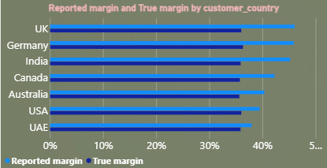</p>

**Finding 2: line items don't reconcile with order totals.**

- **11,226 orders (8.1%)** have line items that don't sum to the order total (0.05 tolerance).
- Line-item net sales total **$192.40M** vs **$177.13M** at header level, a **$15.26M** gap.
- Each line is internally consistent (net, profit and gross all recompute exactly), so the discrepancy is in how lines relate to the order, not in single rows.
- The mismatch is even across statuses (Completed 8.2%, Returned 8.2%, Cancelled 7.8%, Pending 7.9%).
- Worst case: order ORD-182458 has a header total of $285.68 but lines summing to $11,424.99.

**Decision:** keep every row, flag it (`reconciles = Yes/No`), treat the **order table as the source of truth for money**, and use line items only for product mix, filtered to reconciled orders.

**Finding 3: the dataset's own summary file is misleading.** `dataset_statistics.csv` states revenue of **$177.1M** and profit of **$76.1M**. Both include cancelled, returned and pending orders, and both include tax. The realised, tax-free figures are **$127.9M** and **$46.0M**. Its "Total Products Used" (138,116) is the order count, not a product count; the real figure is 1,175.

**Finding 4: "average order value" is inflated by tax.** AOV from `net_sales` shows UK at $1,370 and USA at $1,226. On merchandise revenue it is **$1,115 to $1,144 in every country**. I built a `Merchandise AOV` measure and labelled the original *incl. tax and shipping*.

**Finding 5: seven currencies, no exchange rates.** Average order values are nearly identical across currencies, which suggests a single reporting currency. I treated amounts as one currency and stated the assumption on the report.

**Finding 6: marketing attribution is missing for 60% of orders**, plus another 16.6% under a generic "Default_Campaign" label.

---

## 7. ETL & Data Preparation

All preparation is done in **Power Query (M)**, with a parameterised data folder so the project runs on any machine.

### 7.1 Query architecture

| Query | Loaded? | Purpose |
|---|---|---|
| `DataFolder` (parameter) | n/a | Folder path used by every file source, so paths are not hard-coded |
| `Orders_Staging` | No | Raw orders (staging copy that feeds `Orders`) |
| `validating (order_items VS orders)` | No | Groups order lines by `order_id` and compares line totals with order header totals |
| `Orders` | Yes | Staging joined to the validation result, with the `reconciles` flag |
| `Order_Items` | Yes | Order lines, typed, with line-level validation checks |
| `Customer_Dim` | Yes | Customer master |
| `Product_Dim` | Yes | Product catalogue |

### 7.2 Transformations and cleaning decisions

| Step | Detail | Why |
|---|---|---|
| **Typing** | Numbers, percentages, whole numbers and text set explicitly on every table | Prevents silent text-to-number errors |
| **IDs as text** | `customer_id`, `order_id`, `product_id`, and `customer_postal_code` converted to text | Identifiers are labels, not quantities; postal codes can have leading zeros |
| **Discount as percentage** | `discount_percentage` set to a percentage type | Correct display and maths |
| **Line-level validation** | In `Order_Items`, recompute net sales (`gross + tax − discount + shipping`) and profit (`gross + tax − discount − cost`) and compare, then drop the helper columns | Proves each line is internally consistent before relying on it |
| **Order-level reconciliation** | Sum lines per order, compare with the header, left-join the result to `Orders`, and label it `reconciles` = Yes / No | Quantifies the 8.1% mismatch without deleting any data |
| **Unmatched orders** | Orders with no matching lines would be labelled "No matching item rows" (there are none) | Makes a future data issue visible |
| **Dropped `order_time`** | Removed from `Orders` | Not used by any analysis; reduces model size |
| **No row deletions** | Nothing is filtered out in Power Query | Keeps totals traceable to the source |
| **No imputation** | Structural blanks (ratings, delivery, return reason) are left blank | Imputing would invent customer behaviour |
| **Parameterised path** | `File.Contents(DataFolder & "file.csv")` | Portable, reviewer-friendly |

<details>
<summary><b>Show the line-level validation logic (M)</b></summary>

```
#"Added Custom"  = Table.AddColumn(#"Changed Type1", "calculated_net_sales",
                      each [gross_sales] + [tax_amount] - [discount_amount] + [shipping_cost]),
#"Added Custom1" = Table.AddColumn(#"Changed Type2", "calculated_profit",
                      each [gross_sales] + [tax_amount] - [discount_amount] - [product_cost]),
#"Added Custom2" = Table.AddColumn(#"Changed Type3", "sales_validation",
                      each if Number.Round([net_sales], 2) = Number.Round([calculated_net_sales], 2)
                           then "Match" else "NA"),
...
#"Removed Columns" = Table.RemoveColumns(..., {"profit_validation", "sales_validation",
                      "calculated_profit", "calculated_net_sales"})
```
</details>

<details>
<summary><b>Show how the reconciliation flag is attached to Orders (M)</b></summary>

```
Source = Orders_Staging,
#"Merged Validation" = Table.NestedJoin(Source, {"order_id"},
        #"validating (order_items VS orders)", {"order_id"}, "Validation", JoinKind.LeftOuter),
#"Expanded Validation" = Table.ExpandTableColumn(#"Merged Validation", "Validation", {"validation"}),
#"Replaced Null"   = Table.ReplaceValue(..., null, "No matching item rows", ...),
#"Renamed"         = Table.RenameColumns(..., {{"validation", "reconciles"}}),
#"Match to Yes"    = Table.ReplaceValue(..., "Match", "Yes", Replacer.ReplaceText, {"reconciles"}),
#"NA to No"        = Table.ReplaceValue(..., "NA",    "No",  Replacer.ReplaceText, {"reconciles"})
```
</details>

<!-- 📸 ADD (optional): images/power_query_steps.png - the Power Query editor showing the query list and applied steps. -->
<p align="center">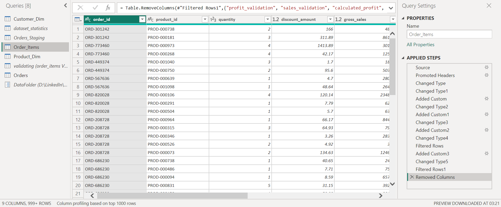</p>

---

## 8. Data Model & Relationships

A star-style model with two fact tables at different grains, three dimensions, and several helper tables.

```
                    ┌────────────────┐
                    │  Customer_Dim  │  25,000 customers
                    └───────┬────────┘
                            │ 1
                            │ customer_id
                            ▼ *
┌────────────┐ 1   * ┌────────────────┐ 1   * ┌────────────────┐ *   1 ┌──────────────┐
│  Date_Dim  │──────▶│     Orders     │──────▶│  Order_Items   │──────▶│ Product_Dim  │
│ (calendar) │ date  │ (fact, order   │ order │ (fact, order   │ prod. │ 1,175 items  │
└────────────┘       │  grain)        │  _id  │  line grain)   │  _id  └──────────────┘
                     └────────────────┘       └────────────────┘

Helper tables (no relationships): Measures Table · Discount Cap (what-if) · Growth Target (what-if)
                                  Geography Metric (field parameter) · Leakage Step (waterfall steps)
```

<!-- 📸 ADD: images/model_diagram.png - a screenshot of Power BI Model view (View > Model) showing all tables and relationships. -->
<p align="center">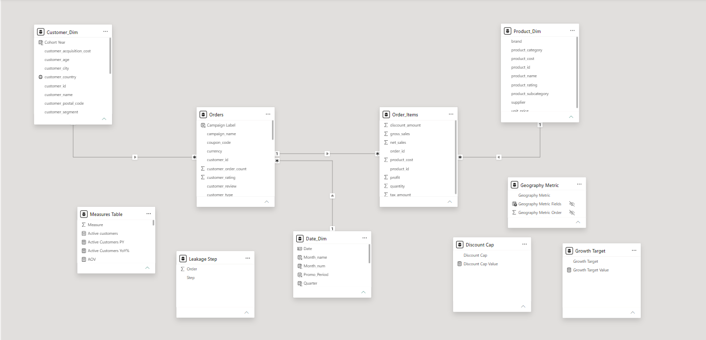</p>

| From (many) | To (one) | Cardinality | Filter direction |
|---|---|---|---|
| `Orders[order_date]` | `Date_Dim[Date]` | Many-to-one | Date → Orders |
| `Orders[customer_id]` | `Customer_Dim[customer_id]` | Many-to-one | Customer → Orders |
| `Order_Items[order_id]` | `Orders[order_id]` | Many-to-one | Orders → Order_Items |
| `Order_Items[product_id]` | `Product_Dim[product_id]` | Many-to-one | Product → Order_Items |

| Model feature | Detail |
|---|---|
| Date table | `Date_Dim` built with `CALENDAR`, marked as the date table, with a Year → Quarter → Month hierarchy; auto date/time turned off |
| Measures | **84 DAX measures** in a dedicated `Measures Table` |
| Calculated columns | about 20 (discount bands, RFM scores, cohort year, promo period, coupon flag, campaign label) |
| Parameters and helpers | Two what-if parameters, one field parameter, one disconnected table for the waterfall |
| Security | Row-level security role *Country Manager - USA* (`[customer_country] = "USA"` on `Customer_Dim`) |

**Modelling decisions**

- **Two fact tables.** `Orders` carries money, status, delivery and customer attributes; `Order_Items` carries what was bought. Keeping each at its own grain avoids double counting.
- **One filter path.** Filters flow from dimensions and the date table into `Orders`, and from `Orders` into `Order_Items`, which removes ambiguity.
- **Order table for money, items for mix.** Because of the reconciliation gap, revenue KPIs come from `Orders` only.

---

## 9. Dashboard Preview & Walkthrough

Each page lists its **purpose**, **what's on it** and **what it shows**. The ranked findings and actions are in [section 10](#10-key-findings--business-recommendations).

### 9.1 Data Trust: *is our profit real?*

<!-- 📸 ADD: images/01_data_trust.png -->
<p align="center">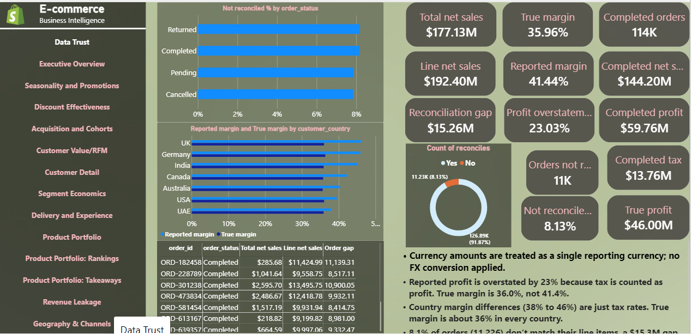</p>

**Purpose:** validate the numbers before anyone relies on them.
**On the page:** cards for reported and true margin, profit overstatement, tax and the reconciliation gap; a donut of reconciled vs non-reconciled orders; a bar chart of reported vs true margin by country; a table of the worst-reconciling orders.
**It shows:** reported profit is overstated by 23% (true margin 36.0% vs 41.4%); the 38% to 46% country spread is tax; 8.1% of orders (11,226) don't reconcile ($15.3M gap).

### 9.2 Executive Overview: *how are we doing?*

<!-- 📸 ADD: images/02_executive_overview.png (select Year = 2025 so the gauge shows) -->
<p align="center">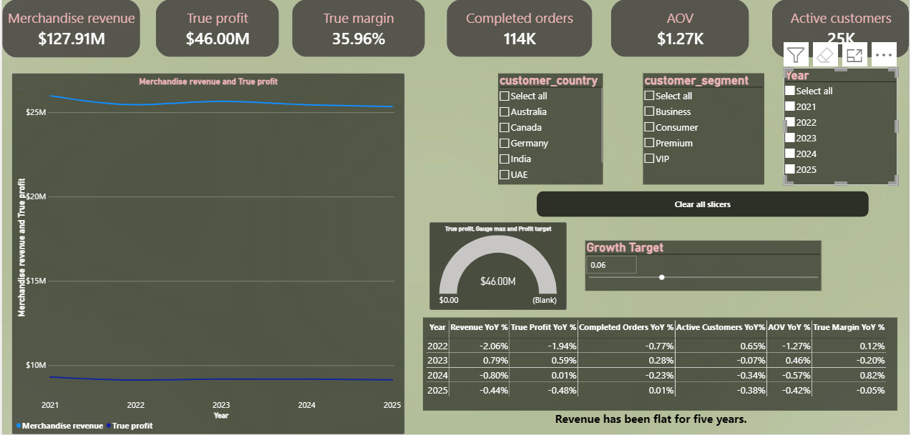</p>

**Purpose:** a one-screen health check with a target.
**On the page:** KPI cards with year-over-year tooltips; a revenue and true-profit trend by year → quarter → month; a year-over-year table; a **gauge against a profit target** driven by a what-if growth slicer; slicers for year, segment and country; a "Clear all slicers" button.
**It shows:** revenue and profit are flat (change within ±2.1% a year; 2025 revenue is 2.5% below 2021); orders hold at about 22,700 a year; with a 5% growth target, 2025 reaches 94.8% of target ($9.15M vs $9.65M).

### 9.3 Seasonality and Promotions: *do promotions make money?*

<!-- 📸 ADD: images/03_seasonality.png -->
<p align="center">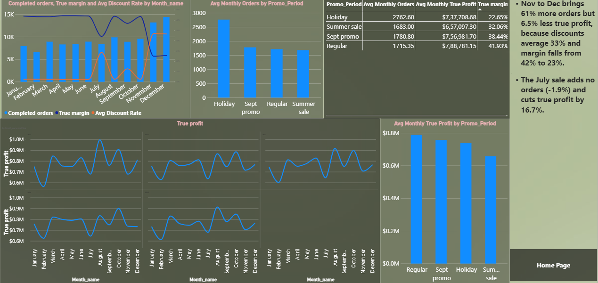</p>

**Purpose:** test whether promotional months earn their discounts.
**On the page:** orders, true margin and discount rate by month; true profit by month with a line per year; a comparison of promo periods.

| Promo period | Avg discount | Orders vs regular | True profit vs regular | True margin |
|---|---|---|---|---|
| Regular months | 11.2% | baseline (about 1,715/month) | baseline (about $789K/month) | **41.9%** |
| Holiday (Nov, Dec) | about 33% | **+61%** | **−6.5%** | **22.6%** |
| Summer sale (Jul) | 24.3% | **−1.9%** | **−16.7%** | 32.1% |
| Sept promo | 16.3% | +3.8% | −4.0% | 38.4% |

### 9.4 Discount Effectiveness: *how deep is too deep?*

<!-- 📸 ADD: images/04_discount_effectiveness.png (cap slicer at 30) -->
<p align="center">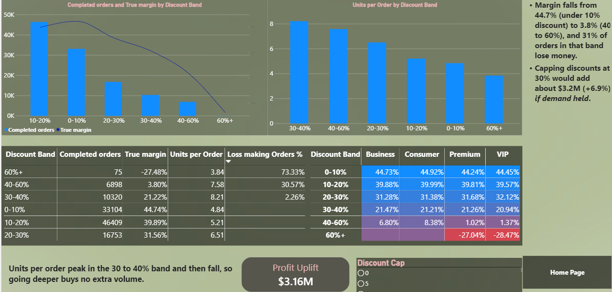</p>

**Purpose:** find the discount level beyond which profit disappears.
**On the page:** orders and true margin by discount band; units per order by band; loss-making share per band; a segment × band matrix; a **what-if discount-cap simulator** (slicer plus profit-uplift card).

| Discount band | Orders | True margin | Units / order | Loss-making |
|---|---|---|---|---|
| 0–10% | 33,104 | **44.7%** | 4.8 | 0% |
| 10–20% | 46,409 | 39.9% | 5.2 | 0% |
| 20–30% | 16,753 | 31.6% | 6.5 | 0% |
| 30–40% | 10,320 | 21.2% | **8.2** (peak) | 2.3% |
| 40–60% | 6,898 | **3.8%** | 7.6 | **30.6%** |
| 60%+ | 75 | −27.5% | 3.8 | 73% |

Units per order peak at 30 to 40% and then fall, so deeper discounts buy no extra volume. A 30% cap raises true profit to **$49.15M (+$3.16M, +6.9%)**; a 40% cap adds $0.84M; a 20% cap adds $7.86M. *The simulator is an upper bound: it assumes customers still buy at the capped price.*

### 9.5 Acquisition and Cohorts: *are we growing the customer base?*

<!-- 📸 ADD: images/05_cohorts.png -->
<p align="center">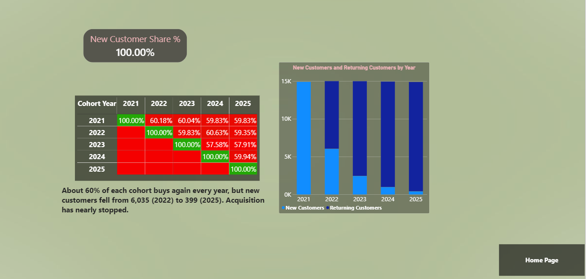</p>

**Purpose:** separate "customers keep buying" from "we keep adding customers".
**On the page:** a cohort retention matrix (cohort year × activity year), new vs returning customers by year, and a new-customer-share card.

| First-order year | New customers |
|---|---|
| 2021 | 14,913 |
| 2022 | 6,035 |
| 2023 | 2,435 |
| 2024 | 966 |
| 2025 | **399** |

Each cohort keeps about **58% to 61%** of its customers buying every year, and active customers stay at about **15,000 a year**, but new customers fell by **93%** from 2022 to 2025 (only 2.7% of 2025's active customers were new). *The data starts in Jan 2021, so the 2021 cohort includes customers acquired earlier.*

### 9.6 Customer Value (RFM) and Customer Detail: *who should we win back?*

<!-- 📸 ADD: images/06_rfm.png -->
<p align="center">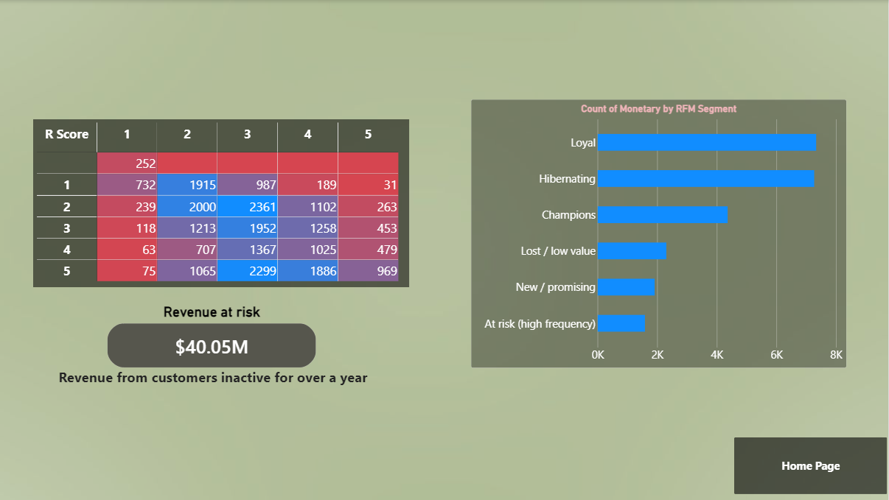</p>

**Purpose:** segment customers by recency and frequency and size the win-back opportunity.
**On the page:** a Recency × Frequency matrix, customers by RFM segment, a revenue-at-risk card, and a **drillthrough** to a customer-level page listing the top 50 customers by value.

| RFM segment | Customers |
|---|---|
| Loyal | 7,329 |
| Hibernating | 7,263 |
| Champions | 4,359 |
| Lost / low value | 2,302 |
| New / promising | 1,910 |
| At risk (high frequency) | 1,585 |
| No completed orders | 252 |

**9,819 customers (39.7%)** haven't bought in over a year, against a median gap of 216 days between orders. At-risk and hibernating customers hold **$40.1M** of historical merchandise revenue.

<!-- 📸 ADD: images/06b_customer_detail_drillthrough.png (reached by right-click > Drillthrough) -->
<p align="center">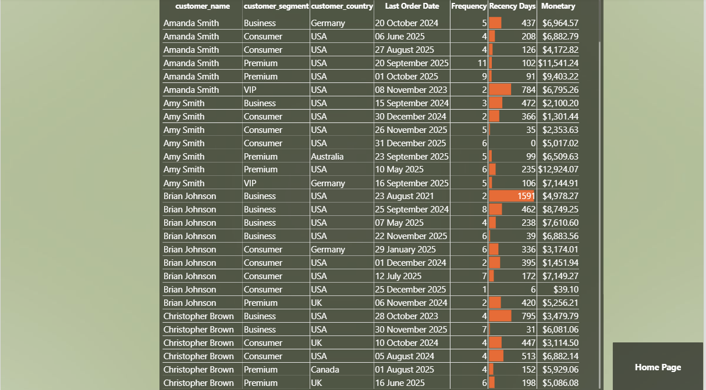</p>

### 9.7 Segment Economics: *are VIP perks paying off?*

<!-- 📸 ADD: images/07_segment_economics.png -->
<p align="center">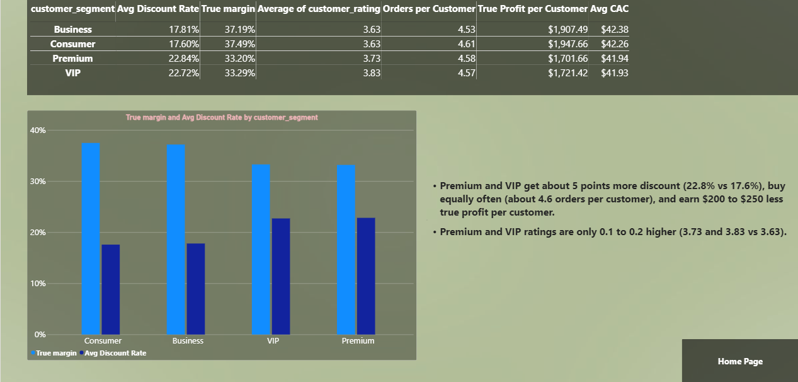</p>

| Segment | Avg discount | True margin | Avg rating | Orders / customer | True profit / customer |
|---|---|---|---|---|---|
| Consumer | 17.6% | 37.5% | 3.63 | about 4.6 | $1,948 |
| Business | 17.8% | 37.2% | 3.63 | about 4.5 | $1,907 |
| Premium | **22.8%** | 33.2% | 3.73 | about 4.6 | **$1,702** |
| VIP | **22.7%** | 33.3% | **3.83** | about 4.6 | **$1,721** |

Premium and VIP customers get about **5 points more discount**, buy equally often, and earn roughly **$190 to $250 less true profit per customer**. The only visible return is a rating 0.1 to 0.2 higher. Average acquisition cost is about $42 per customer, against roughly $1,860 of true profit per customer.

### 9.8 Delivery and Experience: *what does late delivery cost?*

<!-- 📸 ADD: images/08_delivery.png -->
<p align="center">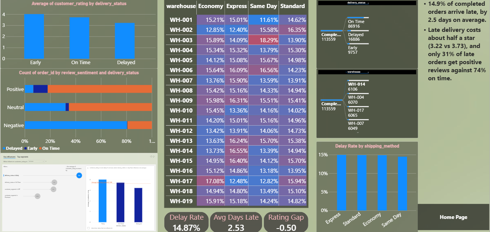</p>

**On the page:** rating and review sentiment by delivery status, cards (delay rate, days late, rating gap), a warehouse × shipping-method delay matrix, two **decomposition trees**, and a **key influencers** visual on customer rating.

| Delivery status | Orders | Avg rating | Positive reviews | Negative reviews |
|---|---|---|---|---|
| Early | 9,757 | **4.02** | 91% | 0% |
| On time | 86,916 | 3.73 | 74% | 0.2% |
| Delayed | 16,886 | **3.22** | 31% | 3.8% |

**14.9%** of completed orders arrive late, by **2.5 days** on average, costing about half a star. Delay rates sit between **14.1% and 15.8% across all 19 warehouses** and **14.5% to 15.0% across all four shipping methods**: there is no outlier, so the problem is systemic. Every shipping method misses its own estimate on average, so the estimates are too optimistic.

### 9.9 Product Portfolio (three pages): *which products earn our profit?*

Product pages use order lines, so they are filtered to **reconciled, completed orders** and say so on the page.

<!-- 📸 ADD: images/09a_product_portfolio.png -->
<p align="center">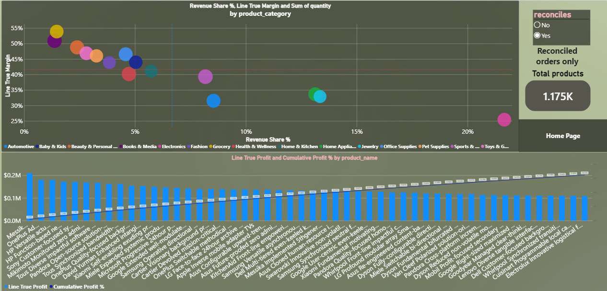</p>

**Category map and concentration:** a scatter of revenue share vs true margin by category, a **Pareto** of the top 50 products with a cumulative-profit line, a product-count card, and headline cards. **Electronics** is the largest category (**21.7%** of revenue) at only **25.4%** margin against 36.0% overall; Jewelry (13.3%, 32.9%) and Home Appliances (13.1%, 33.7%) follow. Profit is spread widely: the **50 most profitable of 1,175 products earn only about 16%**.

<!-- 📸 ADD: images/09b_product_rankings.png -->
<p align="center"></p>

**Rankings:** a top-10 products table, a category and subcategory matrix, revenue share by category, and a brand chart with revenue (columns) and margin (line). The five biggest brands all earn only about 25% to 29% margin.

| Brand | Revenue | True margin |
|---|---|---|
| Samsung | $4.29M | 26.5% |
| LG | $3.77M | 26.4% |
| OnePlus | $3.14M | 27.6% |
| Asus | $3.06M | 24.6% |
| HP | $2.80M | 28.6% |

<!-- 📸 ADD: images/09c_margin_extremes.png -->
<p align="center">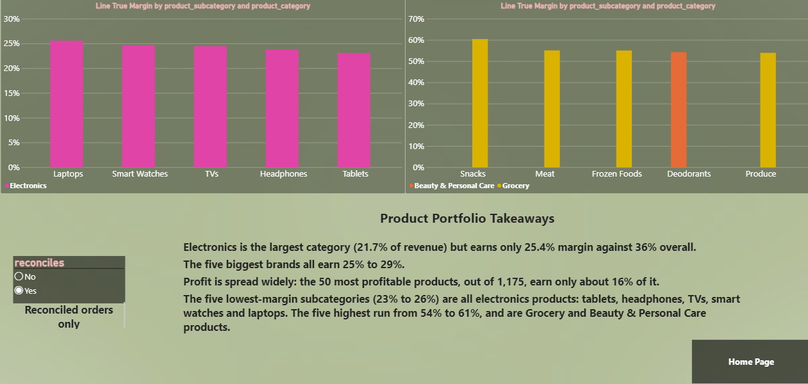</p>

**Margin extremes:** the five lowest subcategories are all electronics (Tablets 23.1%, Headphones 23.8%, TVs 24.5%, Smart Watches 24.7%, Laptops 25.6%); the five highest run from Snacks (60.5%) to Produce (54.0%).

### 9.10 Revenue Leakage: *where does revenue disappear?*

<!-- 📸 ADD: images/10_revenue_leakage.png (waterfall in the correct order) -->
<p align="center">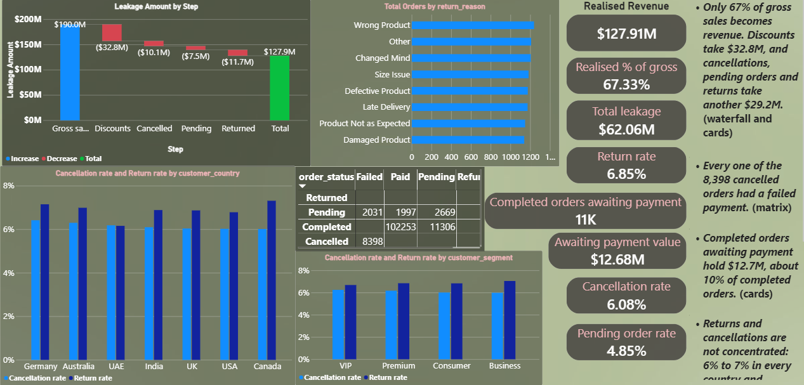</p>

**On the page:** a **waterfall** from gross sales to realised revenue, headline cards, an order-status × payment-status matrix, return reasons, return and cancellation rates by country and segment, and cards for completed orders awaiting payment.

| Step | Amount |
|---|---|
| Gross sales | $190.0M |
| Discounts | −$32.8M |
| Cancelled orders | −$10.1M |
| Pending orders | −$7.5M |
| Returned orders | −$11.7M |
| **Realised revenue** | **$127.9M (67% of gross)** |

Discounts are the largest leak, bigger than cancellations, pending and returns combined ($29.2M). **Every one of the 8,398 cancelled orders had a failed payment.** 11,306 completed orders (10.0%, worth **$12.7M**) are still awaiting payment. Returns and cancellations are not concentrated: 6% to 7% in every country and segment, and each of the eight return reasons causes 12% to 13% of returns.

### 9.11 Geography and Channels: *where and how do we win?*

<!-- 📸 ADD: images/11_geography_channels.png -->
<p align="center">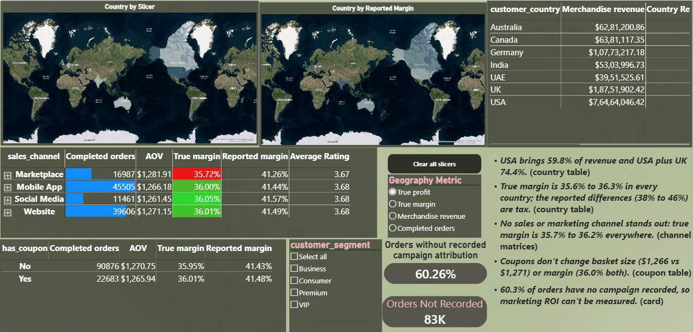</p>

**On the page:** two filled maps (reported margin, and a selectable metric driven by a **field parameter**), a country table, channel matrices, a coupon comparison and campaign-attribution cards.

| Country | Merchandise revenue | Share | True margin | Reported margin |
|---|---|---|---|---|
| USA | $76.5M | **59.8%** | 36.0% | 39.4% |
| UK | $18.8M | 14.7% | 36.0% | 46.0% |
| Germany | $10.8M | 8.4% | 36.3% | 45.8% |
| Canada | $6.4M | 5.0% | 35.7% | 42.2% |
| Australia | $6.3M | 4.9% | 35.6% | 40.3% |
| India | $5.3M | 4.1% | 35.9% | 45.2% |
| UAE | $4.0M | 3.1% | 35.8% | 37.9% |

The USA brings 59.8% of revenue (USA plus UK 74.4%). **No channel stands out:** true margin is 35.7% to 36.0% across sales channels and 35.7% to 36.2% across marketing channels. **Coupons don't change basket size** (AOV $1,266 with a coupon vs $1,271 without) **or margin** (36.0% both) and are used on 20% of completed orders. **60.3% of orders have no campaign recorded.** The *Country Manager - USA* security role was verified with View as (67,978 completed orders, $76.5M).

<!-- 📸 ADD (optional): images/11b_rls_view_as.png - the "View as" dialog with the role applied. -->

---

## 10. Key Findings & Business Recommendations

### 10.1 Ranked findings and actions

| # | Finding | Evidence | Recommendation | Size |
|---|---|---|---|---|
| 1 | **Deep and seasonal discounts earn almost no profit.** Holiday adds 61% more orders for 6.5% less profit; the July sale adds no orders; 40%+ discounts earn 3.8% | 9.3, 9.4 | Cap discounts at about 30%; retire the July sale; test shallower holiday discounts | **+$3.2M** (+6.9%), upper bound |
| 2 | **Reported profit is overstated by 23%** because tax is counted as profit | 9.1 | Adopt true (ex-tax) margin as the standard KPI; correct the source summary | $13.8M of tax counted as profit |
| 3 | **Customer acquisition has nearly stopped.** New customers fell from 6,035 to 399; revenue is flat | 9.5 | Restart acquisition and set a new-customer target | Flat revenue for 5 years |
| 4 | **40% of customers (9,819) are lapsed** | 9.6 | Win-back campaign for At risk and Hibernating customers | **$40.1M** historical revenue |
| 5 | **Every cancelled order is a failed payment**, and completed orders are still awaiting payment | 9.10 | Investigate checkout and payment flow; tighten collection | $10.1M cancelled; **$12.7M** awaiting payment |
| 6 | **Only 67% of gross sales is realised** | 9.10 | Track the leakage waterfall monthly | **$62.1M** total leakage |
| 7 | **VIP and Premium perks don't raise spend**: 5 points more discount, $190 to $250 less profit per customer | 9.7 | Test a smaller perk before scaling the programme | Rating +0.1 to +0.2 only |
| 8 | **Late delivery costs half a star** (14.9% late, 2.5 days) and is systemic | 9.8 | Reset delivery estimates, then review carriers | Ratings 3.73 → 3.22 |
| 9 | **Electronics is the largest category at the thinnest margin** (21.7% share, 25.4% margin) | 9.9 | Review electronics pricing and supplier cost; promote higher-margin categories | 10.6 pts below average |
| 10 | **60% of orders have no campaign recorded** | 9.11 | Fix attribution tracking before judging marketing ROI | ROI currently unmeasurable |
| 11 | **Order lines don't match order totals** for 8.1% of orders | 9.1 | Fix the pipeline upstream | $15.3M gap |
| 12 | **Country, channel and coupons don't change margin** | 9.11 | Don't spend effort optimising these; focus on discounts and acquisition | All about 36% |

### 10.2 Where I would start (suggested sequence)

| When | Actions |
|---|---|
| **First 30 days (quick, low risk)** | Switch reporting to true margin · stop the July sale · reset delivery estimates · fix campaign tracking |
| **30 to 90 days (test and learn)** | Pilot a 30% discount cap on a subset of orders · launch a win-back campaign to At risk and Hibernating customers · investigate checkout payment failures and collect on pending-payment orders |
| **90+ days (structural)** | Rebuild acquisition · redesign the VIP and Premium programme · review electronics pricing · repair the order-line data pipeline |

> Recommendations are suggestions based on this data. The discount simulation in particular ignores how customers would respond.

---

## 11. DAX & Engineering Highlights

### 11.1 Advanced Power BI features used

| Feature | Where |
|---|---|
| **What-if parameters** | Discount cap simulator; growth target for the gauge |
| **Field parameter** with a **dynamic format string** | Geography metric selector (dollars, percentages and counts formatted correctly) |
| **Disconnected table** | Waterfall steps for revenue leakage |
| **Drillthrough** | RFM segment to a customer-level page |
| **Row-level security** | *Country Manager - USA*, tested with View as |
| **Conditional formatting** | Heat matrices, discount bands, retention matrix |
| **Top N filters** | Top 50 customers, top 10 products, top 5 brands, top and bottom subcategories |
| **Decomposition tree and key influencers** | Delivery and rating analysis |
| **Gauge, waterfall, filled maps, scatter, Pareto combo** | Executive Overview, Leakage, Geography, Products |
| **Tooltips and YoY cards** | Executive Overview |
| **Clear-all-slicers buttons, page navigation, clickable logo** | Navigation and usability |

### 11.2 Selected DAX (click to expand)

<details>
<summary><b>True profit and margin (removing tax)</b></summary>

```DAX
Completed profit = CALCULATE ( [Total profit], Orders[order_status] = "Completed" )
Completed tax    = CALCULATE ( SUM ( Orders[tax_amount] ), Orders[order_status] = "Completed" )

True profit            = [Completed profit] - [Completed tax]
Merchandise revenue    = [Completed gross] - [Completed discount]
True margin            = DIVIDE ( [True profit], [Merchandise revenue] )
Profit overstatement % = DIVIDE ( [Completed tax], [Completed profit] )
```
</details>

<details>
<summary><b>Time intelligence (year over year)</b></summary>

```DAX
Merchandise Revenue PY = CALCULATE ( [Merchandise revenue], SAMEPERIODLASTYEAR ( Date_Dim[Date] ) )
Revenue YoY %          = DIVIDE ( [Merchandise revenue] - [Merchandise Revenue PY], [Merchandise Revenue PY] )
```
</details>

<details>
<summary><b>Promo period classification and averages</b></summary>

```DAX
Promo_Period =
SWITCH (
    TRUE (),
    Date_Dim[Month_num] = 7, "Summer sale",
    Date_Dim[Month_num] = 9, "Sept promo",
    Date_Dim[Month_num] IN { 11, 12 }, "Holiday",
    "Regular"
)

Avg Monthly Orders = AVERAGEX ( VALUES ( Date_Dim[Year_Month] ), [Completed orders] )
```
</details>

<details>
<summary><b>Discount bands and the what-if cap simulator</b></summary>

```DAX
Discount Band =
SWITCH (
    TRUE (),
    Orders[Discount Rate] <= 0.1, "0-10%",
    Orders[Discount Rate] <= 0.2, "10-20%",
    Orders[Discount Rate] <= 0.3, "20-30%",
    Orders[Discount Rate] <= 0.4, "30-40%",
    Orders[Discount Rate] <= 0.6, "40-60%",
    "60%+"
)

True Profit at Cap =
VAR cap = 'Discount Cap'[Discount Cap Value] / 100
RETURN
SUMX (
    FILTER ( Orders, Orders[order_status] = "Completed" ),
    Orders[gross_sales]
        - MIN ( Orders[discount_amount], Orders[gross_sales] * cap )
        - Orders[product_cost]
)

Profit Uplift = [True Profit at Cap] - [True profit]
```
</details>

<details>
<summary><b>Cohorts and retention</b></summary>

```DAX
First Order Date = CALCULATE ( MIN ( Orders[order_date] ), Orders[order_status] = "Completed" )   -- Customer_Dim column
Cohort Year      = YEAR ( Customer_Dim[First Order Date] )

Cohort Size = CALCULATE ( DISTINCTCOUNT ( Orders[customer_id] ), Orders[order_status] = "Completed", ALL ( Date_Dim ) )
Retention % = DIVIDE ( [Active customers], [Cohort Size] )

New Customers =
CALCULATE (
    DISTINCTCOUNT ( Customer_Dim[customer_id] ),
    FILTER (
        Customer_Dim,
        Customer_Dim[First Order Date] >= MIN ( Date_Dim[Date] )
            && Customer_Dim[First Order Date] <= MAX ( Date_Dim[Date] )
    )
)
```
</details>

<details>
<summary><b>RFM scoring with blank handling</b></summary>

```DAX
R Score =
IF (
    ISBLANK ( Customer_Dim[Last Order Date] ), BLANK (),
    SWITCH (
        TRUE (),
        Customer_Dim[Recency Days] <= 90, 5,
        Customer_Dim[Recency Days] <= 180, 4,
        Customer_Dim[Recency Days] <= 365, 3,
        Customer_Dim[Recency Days] <= 730, 2,
        1
    )
)

RFM Segment =
IF (
    ISBLANK ( Customer_Dim[Last Order Date] ), "No completed orders",
    SWITCH (
        TRUE (),
        Customer_Dim[R Score] >= 4 && Customer_Dim[F Score] >= 4, "Champions",
        Customer_Dim[R Score] >= 3 && Customer_Dim[F Score] >= 3, "Loyal",
        Customer_Dim[R Score] <= 2 && Customer_Dim[F Score] >= 4, "At risk (high frequency)",
        Customer_Dim[R Score] <= 2 && Customer_Dim[F Score] >= 2, "Hibernating",
        Customer_Dim[R Score] >= 4, "New / promising",
        "Lost / low value"
    )
)
```

*A bug I caught and fixed:* customers with no completed order have a blank recency, and `BLANK() <= 90` evaluates as true, so 252 customers were silently scored as "recent" and counted as "New / promising". The explicit blank check moved that segment from 2,162 to 1,910.
</details>

<details>
<summary><b>Product Pareto (rank and cumulative profit share)</b></summary>

```DAX
Product Rank = RANKX ( ALL ( Product_Dim[product_name] ), [Line True Profit], , DESC )

Cumulative Profit % =
VAR r     = [Product Rank]
VAR cum   = CALCULATE ( [Line True Profit], FILTER ( ALL ( Product_Dim[product_name] ), [Product Rank] <= r ) )
VAR total = CALCULATE ( [Line True Profit], ALL ( Product_Dim[product_name] ) )
RETURN DIVIDE ( cum, total )
```
</details>

<details>
<summary><b>Revenue leakage waterfall (disconnected table + SWITCH)</b></summary>

```DAX
Leakage Step =
DATATABLE ( "Step", STRING, "Order", INTEGER,
    { { "Gross sales", 1 }, { "Discounts", 2 }, { "Cancelled", 3 }, { "Pending", 4 }, { "Returned", 5 } } )

Leakage Amount =
VAR s = SELECTEDVALUE ( 'Leakage Step'[Order] )
RETURN
SWITCH (
    s,
    1, SUM ( Orders[gross_sales] ),
    2, -SUM ( Orders[discount_amount] ),
    3, -CALCULATE ( SUMX ( Orders, Orders[gross_sales] - Orders[discount_amount] ), Orders[order_status] = "Cancelled" ),
    4, -CALCULATE ( SUMX ( Orders, Orders[gross_sales] - Orders[discount_amount] ), Orders[order_status] = "Pending" ),
    5, -CALCULATE ( SUMX ( Orders, Orders[gross_sales] - Orders[discount_amount] ), Orders[order_status] = "Returned" )
)
```

*Design note:* the filtered `SUMX` sits inside each `CALCULATE` rather than in a variable, because a variable is evaluated once before `CALCULATE` changes the filter context.
</details>

<details>
<summary><b>Field parameter with a dynamic format string</b></summary>

```DAX
-- Format string expression on [Selected Geography Metric Value]
SWITCH (
    SELECTEDVALUE ( 'Geography Metric'[Geography Metric Order] ),
    1, "0.0%",
    3, "#,0",
    "$#,0.0,,""M"""
)
```
</details>

<details>
<summary><b>Gauge target (what-if parameter) and row-level security</b></summary>

```DAX
Profit target       = IF ( HASONEVALUE ( Date_Dim[Year] ), [True Profit PY] * ( 1 + 'Growth Target'[Growth Target Value] ) )
Target attainment % = DIVIDE ( [True profit], [Profit target] )

-- Role "Country Manager - USA" on Customer_Dim
[customer_country] = "USA"
```
</details>

---

## 12. Skills & Technologies Demonstrated

| Group | Skills and evidence in this project |
|---|---|
| **Tools and technologies** | Power BI Desktop · Power Query (M) · DAX · CSV data sources · Git and GitHub |
| **Data quality and auditing** | Duplicate, null, referential-integrity and value-sanity checks · arithmetic identity tests · order-to-line reconciliation · detecting that source "profit" includes tax · cross-checking a source summary file |
| **Data engineering (ETL)** | Staging and validation queries · reconciliation flag · explicit typing · parameterised file paths · documented cleaning decisions with no row deletion |
| **Data modelling** | Star-style schema with two fact tables at different grains · date dimension marked as a date table · single-direction relationships · helper tables and a dedicated measures table |
| **DAX** | Time intelligence · `CALCULATE`, `ALL`, `FILTER` and context transition · iterators (`SUMX`, `AVERAGEX`) · `RANKX` · variables · cumulative and percent-of-total logic · `SWITCH(TRUE())` classification · calculated tables and columns · dynamic format strings |
| **Analytical methods** | Cohort retention · RFM segmentation · Pareto analysis · discount-band elasticity · what-if simulation · variance to target · waterfall decomposition |
| **Advanced Power BI** | What-if and field parameters · drillthrough · row-level security · decomposition tree · key influencers · gauge, maps, scatter and combo charts · Top N filters · conditional formatting |
| **Visualisation and UX** | Takeaways tied to visuals · consistent theme and layout · clear-all-slicers buttons · navigation · tooltips · accessibility basics |
| **Business and communication** | Framing questions · turning findings into sized recommendations · reporting null results honestly · documenting assumptions and limitations |

---

## 13. Assumptions & Limitations

**Assumptions**

- **Completed orders only** count towards revenue and profit; cancelled, pending and returned orders are excluded.
- **Merchandise revenue** (gross minus discounts) is the revenue measure; tax and shipping are excluded.
- **A single reporting currency.** Amounts in the seven currencies are treated as comparable, because average order values are almost identical across them. No exchange rates were applied.
- **The order table is the source of truth for money.** Line items are used for product mix on reconciled orders only.
- **Active customer** = at least one completed order in the period.

**Limitations**

- **Synthetic data.** Findings illustrate the method and are not claims about a real company.
- **Order-line mismatch.** 8.1% of orders don't reconcile, so product-level figures are directional.
- **Discount simulator is an upper bound.** It assumes the same volume at a lower discount and does not model customer response.
- **2021 cohort is left-censored.** It includes customers acquired before the data starts.
- **Acquisition cost has no channel**, so CAC and LTV by channel cannot be computed.
- **Campaign attribution is incomplete** (60.3% unrecorded), so campaign-level ROI is not analysed.
- **AOV includes tax and shipping**; use *Merchandise AOV* to compare countries.
- **Repeated order lines.** 87 order-and-product pairs appear twice; they were kept as separate lines.
- **Static takeaways.** Text boxes describe the full period with no slicers selected.

---

## 14. Repository Structure

```
├── dashboard/
│   └── Ecommerce_Sales_Customer_Analytics.pbix
├── data/
│   ├── ecommerce_sales_customer_analytics_150k.csv   # orders (confirm the name Power Query expects)
│   ├── Order_Items.csv
│   ├── Customer_Dim.csv
│   ├── Products_Dim.csv
│   └── dataset_statistics.csv
├── docs/
│   ├── Ecommerce_Sales_Customer_Analytics.pdf        # full report export
│   └── theme.json                                    # Power BI theme
├── images/                                           # screenshots used in this README
└── README.md
```

> The orders CSV is about 49 MB. If GitHub warns about file size, use Git LFS (`git lfs track "*.csv"`) or link to the data source instead.

<details>
<summary><b>Screenshot checklist (filenames for the images/ folder)</b></summary>

Capture each at 100% zoom (View → Fit to page, then Win+Shift+S), 1920 px wide or larger.

| File | What to capture |
|---|---|
| `logo.png` | Your logo or project mark |
| `00_hero.png` | Collage of 3 or 4 best pages |
| `video_thumbnail.png` | A frame from your video with a play icon |
| `power_query_steps.png` | Power Query editor with the query list and applied steps |
| `model_diagram.png` | Model view with all relationships visible |
| `audit_tax_by_country.png` | Data Trust bar chart, reported vs true margin |
| `01_data_trust.png` | Data Trust page |
| `02_executive_overview.png` | Executive Overview with Year = 2025 selected |
| `03_seasonality.png` | Seasonality and Promotions |
| `04_discount_effectiveness.png` | Discount Effectiveness with the cap slicer at 30 |
| `05_cohorts.png` | Acquisition and Cohorts |
| `06_rfm.png` | Customer Value (RFM) |
| `06b_customer_detail_drillthrough.png` | Customer Detail drillthrough page |
| `07_segment_economics.png` | Segment Economics |
| `08_delivery.png` | Delivery and Experience |
| `09a_product_portfolio.png` | Product Portfolio |
| `09b_product_rankings.png` | Product Portfolio: Rankings |
| `09c_margin_extremes.png` | Product Portfolio: margin extremes |
| `10_revenue_leakage.png` | Revenue Leakage with the waterfall in order |
| `11_geography_channels.png` | Geography and Channels |
| `11b_rls_view_as.png` (optional) | "View as" dialog with the USA role |
</details>

---

## 15. How to Access & Reproduce

### 15.1 Open the report

1. Install **[Power BI Desktop](https://powerbi.microsoft.com/desktop/)** (free, Windows).
2. Clone the repository:
   ```bash
   git clone https://github.com/<your-username>/<repo-name>.git
   ```
3. Open `dashboard/Ecommerce_Sales_Customer_Analytics.pbix`.
4. **Point it at the data:** Home → Transform data → **Edit parameters**, set `DataFolder` to the full path of the `data/` folder **including the trailing backslash** (for example `C:\projects\ecommerce\data\`).
5. Click **Refresh**.
6. *Optional:* test security with Modeling → **View as** → *Country Manager - USA*.

**If refresh fails:** check that the CSV file names in `data/` match the names in Power Query (`Order_Items.csv`, `Customer_Dim.csv`, `Products_Dim.csv`, and the orders file), and that `DataFolder` ends with a backslash.

### 15.2 Reproduce from scratch (outline)

1. Load the five CSVs with the typed Power Query steps in [section 7](#7-etl--data-preparation).
2. Build the relationships in [section 8](#8-data-model--relationships), create `Date_Dim` with `CALENDAR`, and mark it as the date table.
3. Create the base measures (`Completed orders`, `Completed gross`, `Completed discount`, `Completed tax`), then the derived measures in [section 11](#11-dax--engineering-highlights).
4. Build the pages in the order of [section 9](#9-dashboard-preview--walkthrough).

### 15.3 Check your refresh against these values

With **no slicers selected**:

| Page | Check | Expected |
|---|---|---|
| Data Trust | True margin / reported margin | 36.0% / 41.4% |
| Data Trust | Orders not reconciled | 11,226 (8.1%) |
| Executive Overview | Completed orders / true profit | 113,559 / $46.0M |
| Executive Overview | Gauge, 2025 at 5% growth | 94.8% |
| Seasonality | Holiday vs regular: orders / true profit | +61% / −6.5% |
| Discount Effectiveness | Profit uplift at a 30% cap | $3,155,425 |
| Cohorts | New customers 2022 / 2025 | 6,035 / 399 |
| RFM | New / promising; revenue at risk | 1,910; $40.05M |
| Segment Economics | Premium discount rate | 22.8% |
| Delivery | Delay rate; rating delayed vs on time | 14.9%; 3.22 vs 3.73 |
| Product Portfolio | Electronics share / margin; product count | 21.7% / 25.4%; 1,175 |
| Revenue Leakage | Realised revenue; % of gross | $127.9M; 67.3% |
| Geography | USA share; coupon vs no-coupon AOV | 59.8%; $1,266 vs $1,271 |
| Security | View as USA: completed orders | 67,978 |

### 15.4 Bugs found and fixed during testing

- A discount-cap formula that returned $0 uplift (the parameter ran 0 to 60, not 0 to 1).
- 252 customers scored as "recent" because a blank recency compared as true.
- A delay-rate measure that divided by all orders (12.2%) instead of completed orders (14.9%).
- A Top N filter that ranked brands by supplier count instead of revenue.
- A discount-rate chart that used an unweighted average while the matrix used a weighted rate.

---

## 16. About Me

**<Your name>** · Aspiring Data / BI Analyst
📧 <your-email> · 💼 [LinkedIn](https://www.linkedin.com/in/<your-profile>) · 🐙 [GitHub](https://github.com/<your-username>)

*I built this project to practise the full analytics workflow, from auditing data to turning findings into decisions. Feedback is welcome.*

<p align="center"><sub>⭐ If you found this project useful, consider starring the repo.</sub></p>
